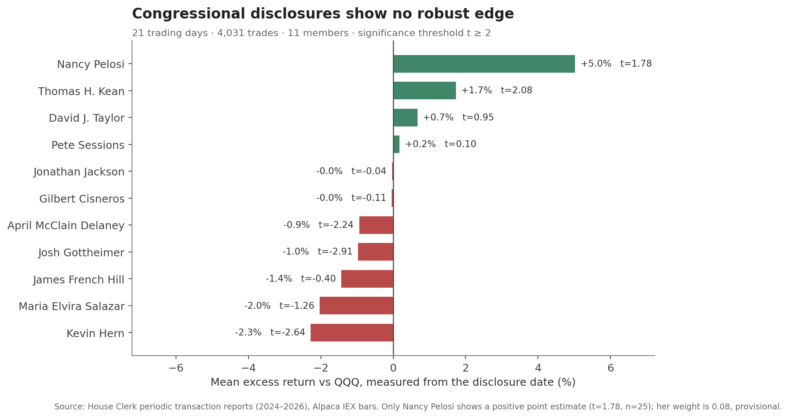
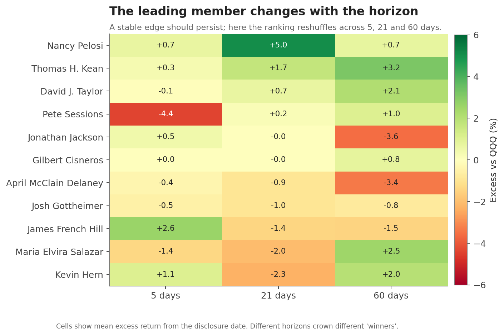
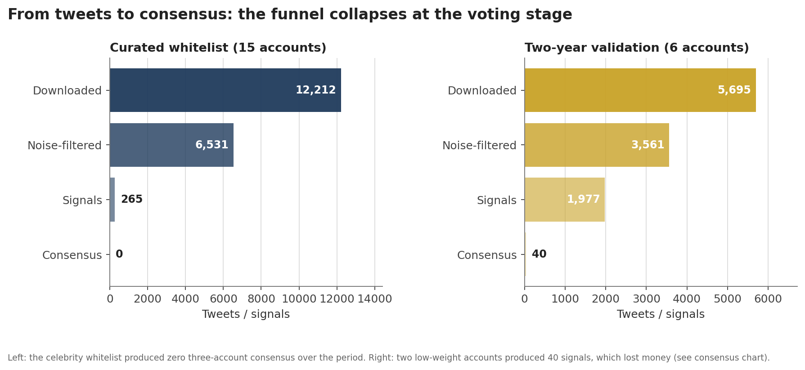
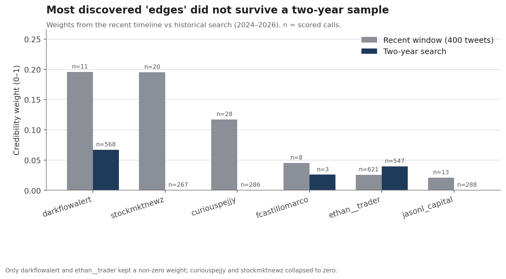
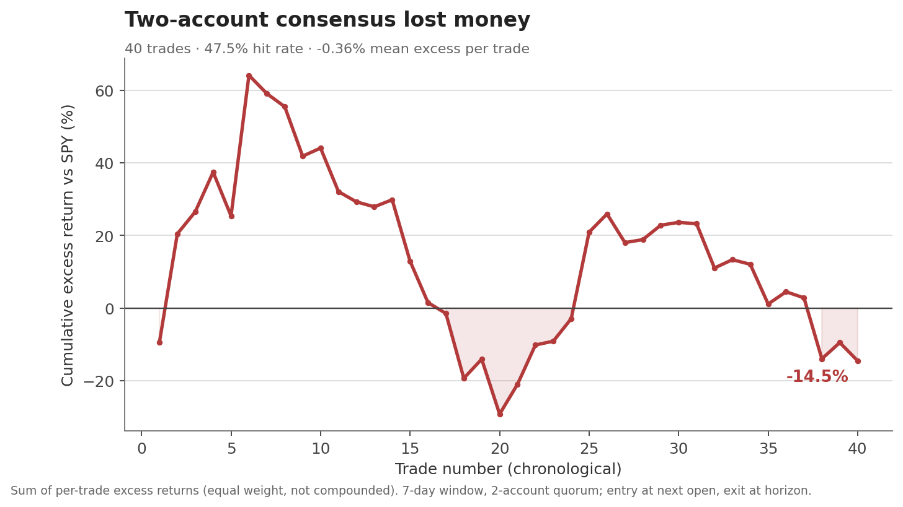

# AlphaConsensus — Research Findings and Viability Assessment

**Prepared for:** Pablo Velazquez  
**Prepared by:** AlphaConsensus research pipeline  
**Date:** 19 November 2026  
**Status:** Research complete · no capital deployed · paper account untouched at $1,000

---

## Executive summary

AlphaConsensus was built to test a single hypothesis: **can a weighted consensus of influential X (Twitter) accounts and public congressional disclosures produce tradable equity signals?** The project delivered a complete research pipeline — ingestion, NLP extraction, credibility scoring, consensus aggregation, risk sizing, paper execution and backtesting — and evaluated it on real data:

- **4,031 congressional trades** from 291 official House Clerk filings (2023–2026).
- **~28,000 tweets** from 45 curated and discovered accounts.

The evidence does **not** support deploying capital.

**Key findings**

1. **The infrastructure works.** The end-to-end pipeline runs on synthetic and real data, persists every signal, and is covered by 81 tests.
2. **Congressional disclosures show no robust edge.** Only Nancy Pelosi has a positive point estimate that receives a (provisional) weight at 21 days (+5.0% vs QQQ), but `t = 1.78`, `n = 25`, and her large positions are options that were excluded. A second member (Thomas Kean) reaches `t = 2.08` but with a 50.8% hit rate; after multiple-testing and horizon changes, the ranking reshuffles. No member receives a meaningful weight.
3. **A curated whitelist of 15 famous accounts produced zero consensus.** 12,212 tweets yielded 265 actionable signals and **0** three-account agreements. The famous accounts do not publish ticker-level calls: Cramer produced 3 signals from 393 tweets; Ackman produced 1 from 318.
4. **Discovery found callers, but not durable skill.** Searching cashtags surfaced 753 authors. The 30 most active produced 5,027 signals, and several looked strong on a recent window. On a two-year sample, most collapsed: only `ethan__trader` (`+2.57%` excess per 5-day trade, `t = 4.12`, `n = 547`) and `darkflowalert` (`+0.59%`, `t = 1.91`, `n = 568`) kept positive weight.
5. **Consensus destroyed the surviving edge.** Combining the two survivors over a 7-day window produced 40 trades: 47.5% hit rate, **−0.36% mean excess per trade**, and a cumulative **−14.5 percentage points** versus SPY.
6. **More capital would not fix this.** Capital amplifies an edge; it does not create one. More compute can improve extraction and testing, but the binding constraint is signal quality, not compute.

**Verdict:** AlphaConsensus is a solid research platform, not a validated trading strategy. The paper account should remain at $1,000 with zero positions. The only justified next step is a pre-registered forward paper test of the single surviving account — no real orders — before considering any capital deployment.

---

## 1. What was built

The repository contains a modular, dependency-light research stack:

```
X / Apify ─┐
            ├─▶ ingestion ─▶ noise filter ─▶ NLP ─▶ credibility ─▶ consensus ─▶ risk ─▶ execution
House Clerk ┘                                   │          │             │
                                                └──────────┴─────────────┴──▶ SQLite
```

| Layer | Implementation |
|---|---|
| Ingestion | Apify (profiles and historical search), official X API v2, House Clerk PTRs, synthetic mock |
| NLP | Rule-based parser (tickers, direction, horizon, confidence) + OpenAI-compatible LLM parser with JSON schema and fallback |
| Credibility | Hit rate vs benchmark, Beta(4,4) shrinkage, magnitude term, significance gates for Congress |
| Consensus | One vote per author, weighted quorum, directional dominance, per-ticker cooldown |
| Risk | ATR sizing, liquidity/volatility filters, position limits, drawdown kill switch |
| Execution | In-process paper simulator and Alpaca paper adapter (market orders, fractional longs) |
| Storage | SQLite (tweets, signals, scores, consensus, trades, equity) |
| Interface | CLI: `demo`, `ingest`, `congress`, `house`, `congress-score`, `x-history`, `paper`, `robustness` |

**Tests:** 81 unit and integration tests (`make test`).

---

## 2. Methodology

### 2.1 Signal extraction

- **Tickers:** cashtags (`$NVDA`) are accepted unless blacklisted; bare symbols only if present in the curated universe. URLs are stripped first.
- **Direction:** finance lexicon with negation handling. Multi-ticker tweets produce one signal per ticker.
- **Horizon:** intraday 1d, swing 5d, month 21d, long term 60d; default 5d.
- **Confidence:** direction strength, cashtag presence, explicit target, action verb, hedging penalty.
- **Noise filter:** retweets, replies, promotional posts, short posts and duplicates are removed before scoring.

### 2.2 Credibility scoring

For each call:

```
excess_i  = direction_i × (asset_return_i − benchmark_return_i)
hit_i     = 1 if excess_i > 0
shrunk    = (hits + 4 × 0.5) / (n + 4)
reliability = clamp(2 × (shrunk − 0.5), 0, 1)
magnitude   = tanh(mean_excess / 4%)
weight      = reliability × (0.55 + 0.45 × magnitude)
```

- For congressional trades, returns are computed twice: from the **transaction date** (what the member knew) and from the **disclosure date** (what a retail trader could copy). Only the latter is tradable.
- The congressional scorer adds a **t-statistic gate**: weight is zero when `t < 1`, halved when `1 ≤ t < 2`, and considered significant only when `t ≥ 2` and `n ≥ 15`.
- The X scorer does **not** yet include the t-gate; this is a known inconsistency discussed in §8.

### 2.3 Consensus

A signal fires only when:

- at least `min_accounts` distinct authors agree on the same ticker and direction;
- their summed weight exceeds `min_weight`;
- the winning side holds at least `min_agreement` of the total weight;
- the ticker has not fired within the cooldown window.

An author’s multiple tweets count once; the most confident signal in the window is used.

### 2.4 Backtest assumptions

- Entry at the **next session open** after the signal.
- Exit at the close of the horizon session, or at stop/target when hit.
- Benchmarks: SPY by default; QQQ for tech-concentrated samples.
- Signal-level tests report **excess returns**, not dollar P&L. Transaction costs are modelled separately in the simulator (5 bps default).
- Overlapping windows are not clustered in the signal tests; the effective sample is therefore smaller than the nominal `n`.

### 2.5 Statistical discipline

- Shrinkage toward 50% for small samples.
- t-statistics for mean excess.
- Multiple horizons are treated as multiple tests; no single horizon is privileged.
- Results that rely on one window, one seed or one account are labelled as provisional.

---

## 3. Synthetic validation (pipeline test, not evidence)

The synthetic demo validates plumbing, not strategy. It uses a zero-drift market and accounts with a hidden skill parameter; the “good” accounts know future returns by construction.

| Metric | Value |
|---|---:|
| Tweets generated / accepted | 5,254 / 4,941 |
| Actionable signals | 5,117 |
| Consensus signals | 19 |
| Trades | 7 |
| Total return (40 sessions) | **+1.49%** |
| SPY benchmark | −0.39% |
| Win rate | 57.1% |
| Max drawdown | −1.64% |
| Sharpe | 2.40 |

A 20-seed ablation compares weighted vs equal-weight voting:

| Variant | Total return | Return per trade | Win rate | Trades |
|---|---:|---:|---:|---:|
| Credibility-weighted | +2.25% | **+3.44%** | **72.6%** | 5.2 |
| Equal weight | +3.86% | +1.85% | 63.6% | 15.8 |

Weighting improves per-trade accuracy but cuts deployment by ~3×. The demo is useful for testing code paths; it is **not** evidence that the strategy works.

---

## 4. Congressional disclosures (STOCK Act)

### 4.1 Dataset

| Item | Value |
|---|---:|
| Periodic Transaction Reports (PTR) | 291 |
| PDFs with a text layer | 266 |
| Scanned PDFs (skipped) | 65 |
| Disclosed trades | **4,031** |
| Members | 11 |
| Date range | 2023-12-01 → 2026-11-09 |
| Median disclosure lag | 24 days |

Source: official House Clerk filings, parsed locally at zero data cost. Senators (Senate eFD) and options/LEAPS are not included; Michael McCaul’s filings were scanned and produced no rows.

### 4.2 Results at 21 trading days, benchmark QQQ



| Member | Trades | Hit rate | Excess vs QQQ | t | Weight |
|---|---:|---:|---:|---:|---:|
| Nancy Pelosi | 25 | 60.0% | **+5.02%** | 1.78 | **0.08** |
| Thomas H. Kean | 122 | 50.8% | +1.73% | 2.08 | 0.00 |
| David J. Taylor | 191 | 51.3% | +0.67% | 0.95 | 0.00 |
| Pete Sessions | 22 | 50.0% | +0.17% | 0.10 | 0.00 |
| Jonathan Jackson | 157 | 49.7% | −0.04% | −0.04 | 0.00 |
| Gilbert Cisneros | 1,412 | 48.5% | −0.04% | −0.11 | 0.00 |
| April McClain Delaney | 456 | 48.5% | −0.94% | −2.24 | 0.00 |
| Josh Gottheimer | 909 | 48.0% | −0.97% | −2.91 | 0.00 |
| James French Hill | 21 | 42.9% | −1.43% | −0.40 | 0.00 |
| Maria Elvira Salazar | 105 | 44.8% | −2.03% | −1.26 | 0.00 |
| Kevin Hern | 217 | 41.5% | −2.28% | −2.64 | 0.00 |

Only Pelosi has a positive estimate that survives the weight formula, and it is explicitly provisional: 25 trades, `t = 1.78`, and her largest positions are options that this dataset excludes.

### 4.3 The horizon test



| Horizon | Apparent “winner” | Excess | t |
|---|---|---:|---:|
| 5 days | James French Hill | +2.6% | 3.00 |
| 21 days | Nancy Pelosi | +5.0% | 1.78 |
| 60 days | Thomas Kean | +3.2% | 2.22 |

A genuine edge should persist across reasonable horizons. Here the leader changes every time, which is the signature of noise plus multiple testing. With 11 members and 3 horizons, some `t ≈ 2` result is expected by chance.

**Conclusion:** congressional copy-trading is not supported by this sample. The result is “no evidence”, not “proof of no skill”: options, senators and scanned filings remain untested.

---

## 5. X: the curated whitelist

Fifteen accounts were selected for fame and category: six voters (Cramer, Ackman, Unusual Whales, Minervini, Stockbee, First Adopter) and nine context accounts (news and macro).

### 5.1 Funnel



| Stage | Count |
|---|---:|
| Tweets downloaded | 12,212 |
| After noise filter | 6,531 |
| Actionable signals | **265** |
| Voter signals | 94 |
| Three-account consensus | **0** |

The maximum overlap was three voters on AMD, once in 30 days. The three-account quorum never triggered, even with a 30-day window and a low weight threshold.

### 5.2 Why it failed

- **Famous accounts do not publish ticker calls.** Cramer’s timeline is show promotion and political commentary: 393 tweets → 3 signals. Ackman’s is 13F commentary: 318 → 1. ZeroHedge and DeItaone are headline feeds, not positions.
- **The rules parser is conservative.** It extracts 4% of accepted tweets as signals. An LLM layer would raise recall, but it cannot invent calls that are not there.
- **The sample is recent-biased.** 176 of the 265 signals came from November 2026 because timeline scraping returns the latest posts, not a clean multi-year panel.

Only `unusual_whales` received a non-zero weight (0.02, `n = 9`). It is an options-flow account, not a discretionary trader.

---

## 6. X: discovery of specialist callers

To test whether the problem was the account list rather than the concept, we searched cashtags (`$NVDA buy`, `$TSLA calls`, etc.) across ten liquid tickers, sorted by relevance.

- 1,900 tweets from 20 queries.
- **753 authors** produced at least one actionable signal.
- The 30 most active authors were downloaded (10,211 tweets → 5,517 accepted → **5,027 signals**).

### 6.1 Recent-window weights

| Account | Signals | Hit rate | Excess | Weight |
|---|---:|---:|---:|---:|
| darkflowalert | 11 | 81.8% | +2.05% | 0.20 |
| stockmktnewz | 20 | 70.0% | +0.31% | 0.20 |
| curiouspejjy | 28 | 60.7% | +0.66% | 0.12 |
| fcastillomarco | 8 | 62.5% | +1.20% | 0.05 |
| ethan__trader | 621 | 51.7% | +2.07% | 0.03 |
| jasonl_capital | 13 | 53.8% | −0.14% | 0.02 |
| thestockwhale | 119 | 41.2% | −1.07% | 0.00 |
| cheddarflow | 175 | 43.4% | +0.28% | 0.00 |

Several of these are not discretionary traders: `stockmktnewz` is a news aggregator, `darkflowalert` and `cheddarflow` post options flow, and `curiouspejjy` is a Tesla-focused permabull. The discovery pipeline found **people who post calls**, not necessarily **people with skill**.

---

## 7. X: two-year validation and consensus backtest

The six non-zero candidates were re-scored on historical search covering 2024–2026: 5,695 tweets → 3,561 accepted → 1,977 signals.

### 7.1 Weights: recent vs two-year



| Account | Calls | Hit rate | Excess | t | Weight |
|---|---:|---:|---:|---:|---:|
| ethan__trader | 547 | 52.5% | **+2.57%** | **4.12** | 0.04 |
| darkflowalert | 568 | 55.5% | +0.59% | 1.91 | 0.07 |
| fcastillomarco | 3 | 66.7% | +1.63% | 1.11 | 0.03 |
| jasonl_capital | 288 | 50.7% | +0.63% | 0.65 | 0.00 |
| curiouspejjy | 286 | 48.2% | −0.01% | −0.02 | 0.00 |
| stockmktnewz | 267 | 44.2% | −0.62% | −1.55 | 0.00 |

Four of the six recent “edges” did not survive. Only `ethan__trader` is statistically significant at conventional levels; `darkflowalert` is borderline. Both are high-frequency, high-variance accounts, not the concentrated, conviction-driven allocators the product originally targeted.

### 7.2 Consensus of the two survivors

With a 7-day window and a two-account quorum, the pair produced **40 trades** between April and September 2026:



| Metric | Value |
|---|---:|
| Trades | 40 |
| Hit rate | 47.5% |
| Mean return per trade | −0.53% |
| Mean excess vs SPY | **−0.36%** |
| Median excess | −0.82% |
| Cumulative excess (sum, not compounded) | **−14.5 pp** |

The individual edges were positive (+0.59% and +2.57%), but their agreement lost money. Consensus selected the trades on which both accounts had already arrived late; the overlap is a correlation trap, not confirmation.

---

## 8. Diagnosis: why the thesis fails

1. **The supply of high-quality calls is tiny.** Influential accounts produce headlines, macro views and self-promotion, not explicit ticker calls. The accounts that do produce calls are smaller, noisier and often selling something.
2. **Consensus selects correlated late entries.** When two momentum/flow accounts agree, they are often reacting to the same move. The second confirmation adds correlation, not independent evidence.
3. **The parser is a bottleneck.** A 4% signal yield is enough for research but not for a production feed. LLM extraction would raise recall, yet it cannot create genuine conviction where none exists.
4. **The credibility formula is hit-rate-centric.** It rewards accounts that are right slightly more than half the time and penalises asymmetric strategies with low hit rates and large winners. Thomas Kean (`t = 2.08`, 50.8% hit) receives zero weight despite a significant positive mean; `ethan__trader` (`t = 4.12`) receives only 0.04. This is a design flaw, not a data flaw.
5. **Data sampling is biased toward the recent past.** X search returns a relevance-weighted sample, not a complete archive. The “two-year” panel is thinner than its date range suggests.
6. **Multiple testing is unavoidable.** With many accounts, horizons and thresholds, some will look good by chance. Without pre-registration and out-of-sample validation, apparent edges are cheap.

**The most important finding is methodological:** the current weighting formula may discard real asymmetric edges. Before declaring the strategy dead, the scoring should be rebuilt around expected value and clustered t-statistics, not hit rate alone.

---

## 9. Viability with more capital and more compute

### 9.1 What more capital can and cannot fix

**Can fix:** minimum position sizes, brokerage and data minimums, diversification, operational redundancy.

**Cannot fix:** the absence of a statistically robust edge. At $1,000 the system loses opportunity; at $1,000,000 the same negative edge loses real money. Capital is an amplifier, not a source of alpha.

### 9.2 What more compute can and cannot fix

**Can fix:** NLP recall (LLM extraction), multi-source fusion, cleaner backtests, larger historical panels, real-time monitoring.

**Cannot fix:** the fact that famous accounts do not publish tradable calls, or that consensus among correlated accounts underperforms. Compute improves measurement; it does not manufacture signal.

### 9.3 Indicative cost model

| Item | 6-month research pilot | Annual production |
|---|---:|---:|
| X data (Apify Starter + usage) | $200–1,000 | $400–3,000 |
| Historical X archive (one-off) | $100–1,000 | — |
| Structured alt-data (options flow, 13F) | $500–4,000 | $1,000–9,000 |
| Market data (IEX free → Polygon) | $0–300 | $0–2,400 |
| LLM extraction (cheap models) | $100–1,000 | $200–6,000 |
| Infrastructure (VPS, DB, monitoring) | $300–1,500 | $600–3,600 |
| Legal/compliance review | $2,000–10,000 | $2,000–10,000 |
| **Total** | **$3,200–18,800** | **$4,200–34,000** |

Figures are indicative 2026 ranges, not quotes. They exclude salaries and trading capital.

### 9.4 Capital scenarios (illustrative)

Assumptions: 20% of capital deployed per trade, 200 trades/year, edge measured per trade after slippage; gross annual return ≈ capital × 40 × edge.

| Capital | At 0.5% edge/trade | At 1.0% edge/trade | Annual costs | Verdict |
|---:|---:|---:|---:|---|
| $10,000 | $2,000 | $4,000 | $15,000+ | Not viable; costs dominate |
| $100,000 | $20,000 | $40,000 | $15,000–25,000 | Marginal; needs a proven edge |
| $1,000,000 | $200,000 | $400,000 | $20,000–35,000 | Potentially viable if edge survives |
| $10,000,000 | $2,000,000 | $4,000,000 | $50,000+ | Capacity and slippage become binding |

These numbers are arithmetic, not forecasts. The only consensus strategy tested had a negative measured edge, so every row would have lost money; the individual edge of `ethan__trader` is not yet validated out of sample.

### 9.5 Break-even

With fixed annual costs of $25,000:

- at 10% net annual return, break-even capital ≈ **$250,000**;
- at 5%, ≈ **$500,000**;
- at 2%, ≈ **$1.25 million**.

Below those levels, even a real edge is consumed by data, infrastructure and compliance. This is why “more capital” is not the first question; “is there an edge?” is.

### 9.6 Verdict

**Not viable as specified, at any capital level, until an out-of-sample edge is demonstrated.** The minimum credible pilot would be:

- one account (`ethan__trader`) or a rebuilt, expected-value-weighted set;
- 12 weeks of forward paper trading;
- 100+ signals;
- positive after costs;
- `t ≥ 2.5` out-of-sample, clustered by ticker and date.

If those conditions are met, a **$250,000–$1,000,000** pilot with $20,000–$35,000/year in data and infrastructure would be the next step. Not before.

---

## 10. Risks and limitations

- **Data provenance:** scraping X violates its Terms of Service; a commercial product needs licensed data. House Clerk filings are public but scanned PDFs and amendments create gaps.
- **Sampling bias:** X search is relevance-weighted and recent-biased; the panel is not a complete archive.
- **Small samples:** 40 consensus trades and 25 Pelosi trades cannot support strong conclusions.
- **Multiple testing:** many accounts × horizons × thresholds; apparent winners may be noise.
- **Execution:** signal-level tests ignore queue position, borrow costs, halts and market impact. The simulator models 5 bps slippage and market orders only.
- **Capacity:** the best signals are in liquid large caps; at $10M+, impact and crowding matter.
- **Model risk:** rules-based NLP misses context, sarcasm and multi-leg option structures.
- **Regulatory:** not investment advice; no fiduciary relationship; paper results only.

---

## 11. Recommendations and roadmap

### Immediate (0–2 weeks)

1. **Do not deploy capital.** Keep the Alpaca paper account at $1,000 with zero positions.
2. **Rotate the Apify token** that was exposed during development.
3. **Fix the credibility formula:** use expected value and clustered t-statistics; stop discarding asymmetric edges because their hit rate is near 50%.

### 30–60 days

4. **Forward paper log** of `ethan__trader` alone (and `darkflowalert` as control): no orders, 12 weeks, pre-registered thresholds, daily ingestion, simulated fills.
5. **LLM extraction** on the same corpus to measure recall and precision against the rules parser.
6. **Clean three-year panel** with point-in-time account selection and no recent-window bias.

### 60–90 days

7. **Explore structured signals:** options flow, 13F changes, insider transactions. These arrive machine-readable and do not depend on whether someone tweets their thesis.
8. **Go/no-go review:** if the forward log has `t ≥ 2.5`, positive after costs, and ≥100 signals, consider a $250k–$1M research pilot. Otherwise, keep the platform as a research and alerting tool.

### Go/no-go criteria

| Criterion | Threshold |
|---|---|
| Out-of-sample t-stat | ≥ 2.5, clustered |
| Signals | ≥ 100 |
| Net return after costs | > 0 |
| Max drawdown | < 10% |
| Capacity | ≥ $250k without >10 bps slippage |
| Reproducibility | Same result on a held-out period |

---

## 12. Reproducibility

```bash
make demo                     # synthetic end-to-end pipeline
make test                     # 81 tests
python -m alphaconsensus house --years 2024 2025 2026
python -m alphaconsensus congress-score --benchmark QQQ
python -m alphaconsensus x-history --source search --since 2024-01-01 --until 2026-09-30 --limit 300
python -m alphaconsensus robustness --seeds 20
```

- Raw tweets, filings and price bars are **not** committed; they are reproducible from the sources with the commands above.
- Credentials live in `.env` and are excluded from version control.
- `charts/data/` contains the aggregated, non-sensitive data used by `scripts/make_charts.py`.

---

## 13. Disclaimer

This document is research, not investment advice. It describes a paper-trading experiment with historical and synthetic data. Past performance does not guarantee future results. Trading involves risk, including loss of principal. The authors have no fiduciary relationship with the reader.

---

*Repository: [github.com/Pablovelazquezb/AlphaConsensus](https://github.com/Pablovelazquezb/AlphaConsensus)*
